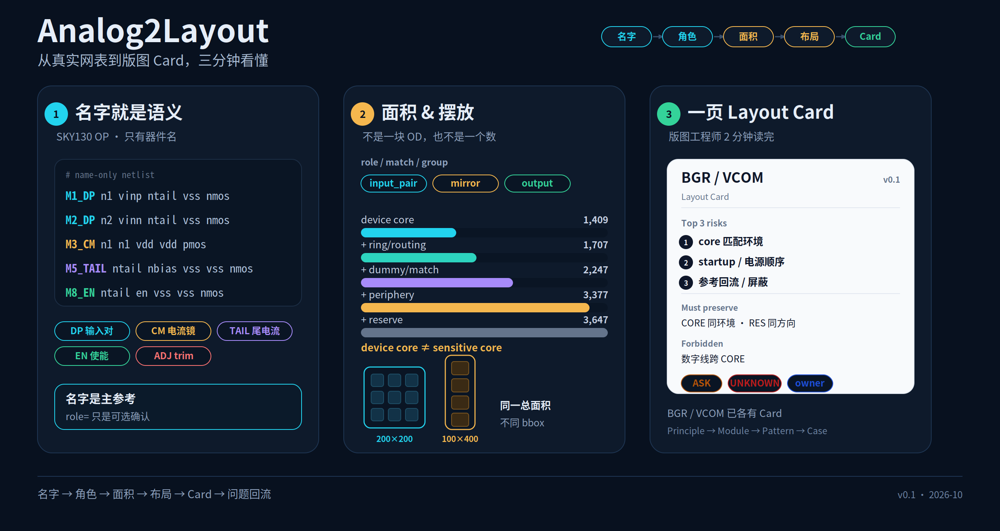
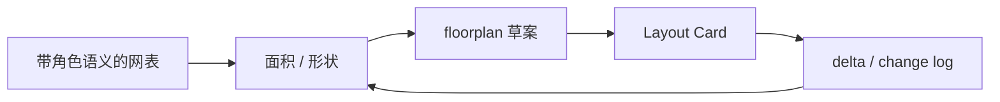
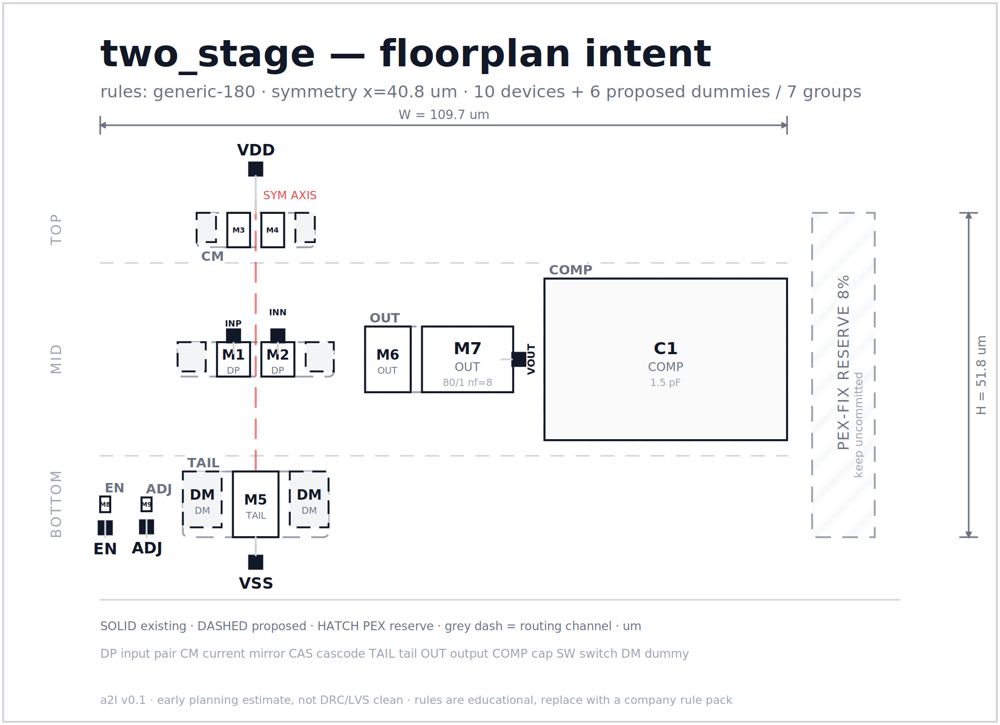
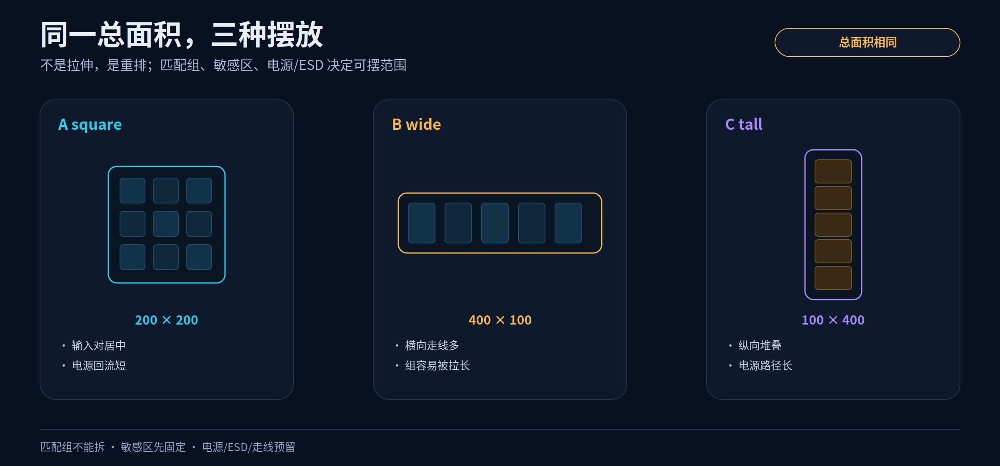

# Analog2Layout

[](https://github.com/XIAHONGYUU/Analog2Layout/actions/workflows/ci.yml)
[](https://github.com/XIAHONGYUU/Analog2Layout)

### 把模拟设计意图编译成版图工程师能直接执行的约束与 Layout Card。

从带角色语义的网表（名字 token 或 `role=`）出发，生成面积结构、floorplan 草案和后期改动清单；Layout Card 按模板由 AI/人编译并经工程师确认（当前为提示词工作流，CLI 不调用 LLM）。当前工作区持续完善：已经能跑的部分保留可运行 demo，正在补的部分继续用结构化文档推进。

> **当前阶段**：v0.1 工作区
>
> **能跑（CLI）**：名字/角色解析 → 五层面积 → 布局草图 → layout delta
>
> **已有示例（非 CLI 生成）**：two-stage / BGR / VCOM 的 Layout Card，按模板整理并经工程师确认
>
> **正在补**：Guideline 的检查与变体、私有规则 overlay
>
> **AI 边界**：提示词与工作流模板，CLI 不调用 LLM
>
> **项目背景与我的角色**：本人负责问题定义、角色语义/面积口径/布局规则与验收；代码、示例与文档在 AI 辅助下完成。

[Layout Guideline](layout-guideline/README.md) · [BGR Card](layout-guideline/02-modules/bgr/layout-card.md) · [VCOM Card](layout-guideline/02-modules/vcom/layout-card.md) · [布局草图 Demo](examples/two_stage/out/floorplan.png) · [Docs](docs/08-ai-layout-guideline.md)



> 一张图：真实网表 → 角色/面积 → 布局变体 → 一页 Card。完整四联图见 [overview.png](docs/diagrams/overview.png)。

## 三分钟看懂

| 你关心 | 入口 | 你会看到 |
| --- | --- | --- |
| 管子角色怎么变成面积？ | [面积报告](examples/two_stage/out/area_report.md) | device core / active / matched / block / envelope，dummy/ring/periphery 分开 |
| 网表只有名字、没有 role？ | [name-only OTA](examples/name_only_ota/README.md) | 名字 token → role/match/group；显式 role 只是可选覆盖 |
| 布局怎么谈？ | [布局草图](examples/two_stage/out/floorplan.svg) | 对称轴、器件编号、dummy、reserve、形状/排列 |
| Layout guideline 怎么不散？ | [BGR](layout-guideline/02-modules/bgr/layout-card.md) / [VCOM](layout-guideline/02-modules/vcom/layout-card.md) | 一页 7 区块 + Principle / Pattern / Case 下钻 |
| 同一原则在不同模块怎么变？ | [BGR vs VCOM](layout-guideline/02-modules/bgr-vcom-comparison.md) | 匹配/电源/ESD 的优先级差异 |
| PEX 后改动怎么提前？ | [layout delta](examples/two_stage/out/layout_delta.json) | owner、status、面积影响、reserve shortfall |

> **第一个真实目标**：[SKY130 两级 Miller OP](docs/11-target-sky130-opamp.md)。10 个 MOS + 1 个补偿电容，包含真实的 bias/enable 辅助管；[网表](examples/sky130_two_stage_opamp/opamp.sp) · [来源与许可](examples/sky130_two_stage_opamp/README.md)。

## 一条链



## 当前状态

| 状态 | 内容 |
| --- | --- |
| 能跑（CLI） | 名字/角色解析 → 五层面积 → 布局草图 → layout delta |
| 已有示例/脚手架（非 CLI 生成） | BGR / VCOM / two-stage OTA 的 Layout Card；Principle → Module → Pattern → Case 的文件夹与模板 |
| 正在补全 | 真实 PDK / 公司规则 / 完整私有 overlay；更多模块（LDO / SADC / AFE_CH）与 case；敏感区/复用模型、目标 bbox 变体、card 完整性检查、工具链适配 |

## 这个项目体现的能力

- **模拟语义建模**：把“这个管子是干什么的”变成 role / match / group / layout，再映射到面积与物理意图。
- **版图物理判断**：匹配、电源回路、寄生、ESD/高压、密度，不停留在“加 dummy / 加宽 / 屏蔽”的口号。
- **AI-native 工作流**：intent → Layout Card → 版图反馈 → change log，让 AI 编译和检查缺口，而不是替人做签核。

---

## 1. 具体痛点与产物

| 痛点 | a2l 的做法 | 产物 |
| --- | --- | --- |
| 早期只能凭经验估面积，无法按面积选架构 | 用 `role=` / `match=` / `group=` 标注器件语义，规则引擎按版图规则估算面积，并给出范围 | `area_report.md/json` |
| 模拟和版图对“怎么摆”反复口头沟通 | 从器件角色和匹配关系生成 **布局草图（floorplan intent）**，带器件编号、对称轴、匹配组、预留通道 | `floorplan.svg/json` |
| PEX 之后才发现要加 dummy、补电容、改 finger，导致重新验证 | 在布局阶段就生成 **layout-induced schematic delta** 清单，标出 owner、原因、面积影响和 PEX 复测范围 | `layout_delta.json` / `HANDOFF.md` |
| Layout guideline 散落在会议、经验、项目里，版图工程师抓不住重点 | 把 guideline 变成 **Principle → Module → Pattern → Case** 四层，先给一页 Layout Card | `layout-guideline/` |

一句话：**先让 AI 读懂“管子是干什么的”，再把模拟意图编译成版图工程师一眼能用的 Layout Card。**

---

## 2. 快速开始

要求：Python 3.10+，无第三方运行时依赖。

```bash
# 在仓库根目录
python3 -m a2l build examples/two_stage/two_stage.sp --out examples/two_stage/out --area-budget-mm2 0.005 --fail-on-gate

# 打开一页式交接包
xdg-open examples/two_stage/out/index.html
```

也可以直接看：

- [布局草图 SVG](examples/two_stage/out/floorplan.svg)
- [交接单 HANDOFF.md](examples/two_stage/out/HANDOFF.md)
- [面积报告](examples/two_stage/out/area_report.md)
- [后期改动清单](examples/two_stage/out/layout_delta.json)
- [AI-native Layout Guideline](layout-guideline/README.md)
- [two-stage OTA 的一页 Layout Card](layout-guideline/02-modules/two-stage-ota/layout-card.md)
- [name-only OTA 示例](examples/name_only_ota/README.md)
- [SKY130 两级 Miller OP](examples/sky130_two_stage_opamp/README.md)

常用命令：

```bash
python3 -m a2l analyze   examples/two_stage/two_stage.sp
python3 -m a2l floorplan examples/two_stage/two_stage.sp --out out/fp
python3 -m a2l build     examples/two_stage/two_stage.sp --out out/two_stage --area-budget-mm2 0.005 --fail-on-gate
python3 -m a2l compare   examples/ota5/ota5.sp examples/ota5_cascode/ota5_cascode.sp
python3 -m a2l validate  examples/two_stage/two_stage.sp
python3 -m a2l validate  examples/name_only_ota/ota_named.sp --require-known-roles
python3 -m a2l roles
```

`build` 会生成：

```text
index.html          一页式交接包（内嵌 SVG + 表格）
floorplan.svg       布局草图
floorplan.json      坐标、端口、通道、分组
area_report.md      人类可读的面积报告
area_report.json    机器可读的面积明细
layout_delta.json   后期改动清单（dummy/decap/reserve/...）
HANDOFF.md          给模拟/版图评审用的交接单
```

---

## 3. 核心约定：给管子一个“角色”

真实的模拟仿真/验证网表通常**只有器件名**，没有 `role=` 属性。所以在 a2l 里，**名字是主要的语义参考源**；显式属性是可选的“人工确认/覆盖”，不是前提。

```spice
* 真实网表常见形态：只有名字
M1_DP n1 vinp ntail vss nmos w=5u l=0.5u nf=4 m=1
M2_DP n2 vinn ntail vss nmos w=5u l=0.5u nf=4 m=1
M3_CM n1 n1 vdd vdd pmos w=5u l=1u nf=2 m=1
```

```spice
* 可选：人工确认/覆盖
M1 n1 vinp ntail vss nmos w=5u l=0.5u nf=4 m=1 \
   role=input_pair match=DP group=IN layout=common_centroid
```

> **职责边界**：角色表（role taxonomy）和规则包（rule pack）的 owner 是**模拟工程师/模拟团队**。AI/agent 可以提出候选、检查覆盖、解释结果，但不能自行批准新增 role 或修改 rule 数值。`a2l validate --require-known-roles` 可以在 CI 里检查是否有 `unknown`，但不会要求每个器件都写 `role=`。相关决定记录在 [`DECISIONS.md`](DECISIONS.md)。

| 字段 | 含义 | 例子 |
| --- | --- | --- |
| `role` | 器件在电路中的功能 | `input_pair`, `current_mirror`, `cascode`, `tail_current`, `output_stage`, `enable_switch`, `adj_switch`, `compensation`, `decap`, `dummy` |
| `match` | 必须电气匹配的器件组 | `DP`, `CM`, `CAS`, `TAIL` |
| `group` | 功能/布局分组，可与 `match` 不同 | `IN`, `LOAD`, `OUT`, `BIAS` |
| `layout` | 期望的版图模式 | `common_centroid`, `interdigitated`, `stacked`, `minimal` |
| `ratio` / `tunable` / `constraints` | 可选，和 AnalogLoop manifest 对齐 | `ratio=1`, `tunable=true`, `constraints=[same_wl]` |

完整角色表见 [`docs/02-annotation.md`](docs/02-annotation.md)，或运行 `python3 -m a2l roles`。

### 为什么以名字为主？

因为真实网表里往往没有别的语义来源。名字是设计者留下的**真实参考信号**：

1. **名字是主参考**：`M1_DP`、`M3_CM`、`M5_TAIL`、`M8_EN` 里的 token 直接给出角色；
2. **match/group 也从名字推断**：同一 token（`DP`、`CM`、`TAIL`）被提议为同一个匹配组；
3. **属性是覆盖**：`role=` / `match=` 用于人工确认、例外、重构后的兼容；
4. **不猜**：名字没有语义 token 时标 `unknown`，不要用拓扑硬猜成确定角色；
5. **AI 可建议**：agent 可以结合拓扑/注释给出候选，但必须经过模拟工程师确认。

---

## 4. 面积模型：可解释，而不是“拍脑袋”

对每个 MOS：

```text
W_total   = w × nf × m                 （默认 w 为单 finger 宽度，可配置）
W_finger  = W_total / (nf × m)
finger_pitch = L + 2×SD_ext + contact_spacing
OD_area   = (nf × finger_pitch) × (W_finger + 2×OD_ext)
ring_area = 2×(W_layout + H_layout)×ring_width + 4×ring_width²   （关键器件）
routing   = (OD_area + ring_area) × routing_overhead
device    = OD_area + ring_area + routing
```

对电容：

```text
area = C / cap_density
```

对匹配组和模块：

```text
group = (Σ device + dummy×dummy_area) × (1 + matching_overhead)
block = (√(Σ group) + 2×periphery)² × (1 + global_routing)
range = block × [low_factor, high_factor]
reserve = block × reserve_fraction
```

### 面积口径：五层，而不是一个数

| 层级 | 定义 | 包含 | 不包含 |
| --- | --- | --- | --- |
| **Device core** | 当前实现的纯器件核心 | MOS 的 OD footprint、电容极板面积 | ring、routing、dummy、periphery |
| **Active** | 核心区 + 器件环境 | core + guard ring + 器件级 routing | dummy、matching overhead、periphery |
| **Matched** | 可匹配的器件区 | active + boundary dummy + matching overhead | 模块 periphery、block routing |
| **Block** | 模块 committed area | matched + periphery + block routing | PEX-fix reserve |
| **Envelope** | 模块总占地 | block + PEX-fix reserve | 模块外的封环/测试结构 |

> 这里的 Core 是 **device core**，不是实际版图里说的 **sensitive core**。敏感区还要加 ring、WPE/STI 强制间距、dummy、屏蔽、关键走线预留；敏感区/非敏感区的划分和复用见 [`layout-guideline/01-principles/sensitive-region-reuse.md`](layout-guideline/01-principles/sensitive-region-reuse.md)。

报告里同时给出 **dummy 面积、ring、device routing、matching overhead、periphery、reserve**，所以“加 dummy 后多少”“核心区占比多少”“是不是方正”都能拆开看。

### 形状与排列

`floorplan.json` 的 `stats` 会给出：

- `block_width_um` / `block_height_um`：模块 bbox；
- `aspect_ratio`：W/H；
- `squareness`：`min(W,H)/max(W,H)`，1.0 表示正方形；
- `orientation`：`landscape` / `portrait` / `square-ish`；
- `rows`、`groups_by_band`：怎么排的；
- `arrangement`：一句话描述行数、每行组数、对称轴；
- `core_utilization` / `whitespace_fraction`：device core 占比和空白率。

示例：两阶段 OTA 的 block 是 **107 × 51.8 µm，aspect 2.07，squareness 0.48，landscape**；`HANDOFF.md` 会直接写出这个结论，方便模拟工程师判断“这个形状是否适合目标模块”。

### 面积门：PASS / REJECT / UNCERTAIN

给定 `--area-budget-mm2 0.005` 时，a2l 用 `area_low/high` 做三值判断：

```text
area_high <= budget      → PASS
area_low  >  budget      → REJECT
otherwise                → UNCERTAIN（区间跨过 budget，需要 refine 或 layout check）
```

示例：budget 5000 µm²，range 2701–4558 µm² → **PASS，headroom 442 µm²**。CI 里加 `--fail-on-gate` 后，REJECT/UNCERTAIN 会直接让构建失败，而不是只打印一行警告。

所有系数都来自 [`rules/generic_180.json`](rules/generic_180.json)，报告里能追溯到具体 rule key；公司规则包的创建/校准约定见 [`rules/README.md`](rules/README.md)。**它的价值是比较架构、暴露面积大头、提前发现 dummy/decap 的成本，而不是替代签核提取。**

> 真实落地时，规则包必须替换为公司/工艺厂的规则，并用历史已完成版图做校准（见 roadmap 的 calibration）。

---

## 5. 布局草图：给版图工程师一张能直接讨论的图

> 术语说明：Virtuoso 里的 **white line** 是 schematic 上的标志辅助线；这里输出的 `floorplan.svg` 是独立的**布局草图 / floorplan sketch**，两者不是同一个概念。详见 [`docs/09-white-line-and-floorplan.md`](docs/09-white-line-and-floorplan.md)。

`floorplan.svg` 不是合法版图，而是**布局意图**：



- 输入对跨对称轴摆放；
- 电流镜在上、尾电流在下；
- 输出级和补偿电容在右；
- 偏置/开关在左下；
- 每个器件有编号（`M1`、`M2`、…）；
- 匹配组用虚线框住，并标出 `DP`、`CM` 等；
- dummy 用虚线框表示“提议，不是已插入”；
- 右侧斜线区域是 **PEX-fix reserve**；
- 底部标出 routing channel、对称轴和规则包版本。

版图工程师可以在这张图上直接标“这里要加 guard ring”“这个 dummy 不要”“输出要换方向”，模拟工程师也可以用它比较不同架构的面积。

---

## 6. AI-native Layout Guideline

> 这是本工作区现在最核心的部分：不是再写一份更长的 Layout Guideline，而是把 guideline 变成一个**可编译、可下钻、可版本化**的文件夹和工作流。

### 为什么 guideline 最难

- 只有结论、没有原因：“这里加 dummy”说不出是为了匹配、密度还是 ESD；
- 只有通用原则、没有模块特性：BGR 的匹配和 VCOM 的匹配不是同一优先级；
- 只有画法、没有边界：某项目的线宽/via 数被当成通用规则。

### 四层结构

```text
Principle（为什么）
    ↓
Module（这个模块最怕什么）
    ↓
Pattern（这类电路怎么画）
    ↓
Case（以前哪里错过 / 怎么验证）
```

版图工程师先看 **一页 Layout Card**，需要时再下钻。

### 一页 Card 的 7 个区块

1. 模块一句话 + 信号链
2. Top 3 risks
3. Must preserve
4. Forbidden
5. Device / match / group 表
6. Floorplan + 关键区域
7. Evidence / open questions / owner / version

### 工作流

```text
模拟填 intent + 名字/role 语义
  → AI 编译 Layout Card（标出 ASK/UNKNOWN，不发明规则）
  → 版图读 Card，标偏差
  → 双方解决 open questions
  → 更新 card / case，版本 +1
  → 问题回流 07-problems → principle/pattern 更新
```

### 问题驱动迭代

Layout Guideline 的价值不在“写得多全”，而在**以前项目的问题不再重复犯**：


- 每个真实问题记录到 `07-problems/`：现象、机制、版图动作、guideline 缺口；
- 同一机制出现 ≥2 次，必须产生一条 principle/pattern/module/card/rule 变更；
- 新问题先查 `07-problems/` 和 `04-cases/`，避免重复条目；
- 项目特定数值进 private rule pack，不写进 public principle。

### 同一总面积，不同摆放

版图布局不是“一个固定模板”。同一总面积，200×200、100×400、400×100 会得到不同摆放；器件类型/参数、匹配组、敏感区、电源/ESD 和走线预留都会约束布局。当前 demo 只生成默认 band 布局，下一步会支持目标 bbox / aspect 的候选变体。详见 [`docs/10-layout-variants.md`](docs/10-layout-variants.md)。



### 入口

- [layout-guideline/README.md](layout-guideline/README.md)
- [docs/08-ai-layout-guideline.md](docs/08-ai-layout-guideline.md)
- [two-stage OTA Layout Card](layout-guideline/02-modules/two-stage-ota/layout-card.md)
- [BGR Layout Card](layout-guideline/02-modules/bgr/layout-card.md)
- [VCOM Layout Card](layout-guideline/02-modules/vcom/layout-card.md)
- [Layout Card 模板](layout-guideline/05-templates/layout-card.md)

> 这个工作区只体现**技术交互**：intent、card、floorplan、delta、change log。
>
> 不做培训助手、主审、审计这类服务型功能。

---

## 7. 把 PEX 后的“小改动”提前变成清单

`layout_delta.json` 里的每一条都有：

```json
{
  "id": "D001",
  "kind": "dummy",
  "target": "DP (M1, M2)",
  "action": "Add 2 boundary dummy device(s); see the dashed DM blocks in the floorplan",
  "reason": "Preserve edge matching for input_pair",
  "owner": "layout",
  "status": "proposed",
  "area_delta_um2": 42.0,
  "confidence": "rule",
  "rule": "matching.dummy_per_group"
}
```

当所有提议的 delta 面积超过 reserve 时，`HANDOFF.md` 和 `index.html` 会直接报出 shortfall，避免“预留了 8%，结果 decap 一个人就吃掉 44%”这种假预留。

这样做的目的不是“消灭 PEX 迭代”，而是把**可预测的迭代**变成：

- 模拟工程师提前决定要不要加 dummy switch / decap；
- 版图工程师提前预留面积和通道；
- 评审时只讨论例外，不用每次从零解释；
- PEX 后如果仍要改，能明确是“清单之外的意外”，而不是“早就知道但没人说”。

当前会检查：匹配组边界 dummy、输入对 guard ring、电流镜 dummy 分支、cascode dummy、尾电流 dummy、输出 finger/EM、使能与 trim 开关的 dummy、decap 提议、PEX-fix reserve。

---

## 8. 为什么是“确定性引擎 + AI agent”，而不是纯 LLM

- **几何和规则必须可追溯**：面积、坐标、dummy 数量不能由模型“感觉”出来；
- **AI 适合做语义层**：从拓扑/注释推断 role、把 module intent 编译成 Layout Card、解释某条 delta 的原因；
- **agent 不能发明规则**：所有 rule key 必须来自规则包；不确定时标 `unknown`/`ASK`；
- **角色/规则归模拟工程师**：AI 只提议 role、检查覆盖、解释结果，不批准 taxonomy 或 rule 数值；
- **不做服务型功能**：不提供培训助手、主审、审计；只输出技术交互所需的 intent/card/floorplan/delta/change log。

仓库里的 [`agent/prompts/`](agent/prompts/) 提供了 role 解析和 Layout Card 编译的 prompt 模板；[`AGENTS.md`](AGENTS.md) 规定了在这个仓库里工作的 AI agent 的边界。

---

## 9. 仓库结构

```text
a2l/                    确定性核心
  netlist.py            SPICE-like 解析、role/match/group/layout
  roles.py              角色 taxonomy + 名字解析（主参考）
  rules.py              规则包加载
  area.py               面积模型
  floorplan.py          分组、band、对称、坐标
  svg.py                布局草图渲染
  delta.py              layout-induced schematic delta
  report.py             Markdown / JSON / HTML 交接包
  cli.py                命令行
rules/
  generic_180.json      教学用规则包（非 PDK）
  README.md             规则包字段、校准和公司 pack 约定
examples/
  two_stage/            两阶段 Miller OTA（完整演示）
  ota5/                 5T OTA（最小例子）
  ota5_cascode/         cascode 版本（面积对比）
  name_only_ota/        只有名字、没有 role= 的网表示例
  sky130_two_stage_opamp/  SKY130 两级 Miller OP（真实开源基线 + bias/enable）
layout-guideline/       AI-native Layout Guideline 工作层
  00-workflow/          角色、步骤、交付物、版本
  01-principles/        匹配、电源、寄生、ESD、敏感区/复用
  02-modules/           模块 card（two-stage OTA / BGR / VCOM）
  03-patterns/          diff pair、current mirror、resistor/cap array、trim、output
  04-cases/             脱敏案例
  05-templates/         card / intent / area-target / change-log 模板
  06-sources/           公开/私有边界与证据等级
  07-problems/          问题记录 → guideline patch
docs/                   问题、标注、面积、floorplan、white line 区分、variants、真实目标、guideline、roadmap
  diagrams/             三分钟总览 / 完整四联图 / 变体 / 问题闭环
agent/prompts/          role 解析 + Layout Card 编译 prompt
schemas/                annotation / area_report / floorplan / delta 的 JSON Schema
DECISIONS.md            角色归属、面积口径、形状指标等 durable decisions
CITATION.cff / DISCLAIMER.md  引用信息与边界声明
tests/                  unittest，无第三方依赖
```

---

## 10. 路线图

**v0.1（当前）**
- 名字作为主参考 + 可选显式覆盖 + `--require-known-roles`
- name-only 网表示例 + match/group 推断
- 五层面积口径：core / active / matched / block / envelope（device core）
- 敏感区/复用原则 + 布局草图术语澄清（vs Virtuoso white line）
- 形状/排列指标：bbox、aspect、squareness、rows、groups/band
- 三值面积门 PASS / REJECT / UNCERTAIN + `--fail-on-gate`
- 规则驱动面积 + 区间 + dummy/ring/routing/periphery 分解
- 布局草图 SVG/JSON + 端口/通道/对称轴 + reserve
- layout delta + HANDOFF + HTML 交接包
- role/rule ownership + `--require-known-roles`
- AI-native Layout Guideline 文件夹 + 工作流
- 一页 Layout Card 示例：two-stage OTA / BGR / VCOM
- BGR vs VCOM 的模块优先级对比
- 目标 bbox/aspect 的变体概念 + 问题回流 `07-problems/`
- SKY130 两级 Miller OP 真实目标（10 MOS + 1 cap，含 bias/enable）
- 五个示例 + 测试 + CI

**v0.2**
- 面积模型：device_core / sensitive_core / flexible_area / reuse_candidate
- target bbox/aspect 的 floorplan 变体生成器（square / wide / tall）
- 2–3 条真实问题记录 → guideline patch
- 拓扑辅助的 role 建议（diode-connected、mirror、cascode、switch、output）
- 增加 2–3 个模块 card（LDO / SADC / AFE_CH，均为脱敏/合成）
- 增加 5–8 个 pattern card（cascode、guard ring、power grid、ESD clamp 等）
- card 完整性检查：缺 `ASK`/`UNKNOWN`/owner/证据时给出提示（不是主审）
- 从 case 回流：把“返工原因”整理成 pattern/principle 候选

**v0.3**
- KLayout / GDS 导入，对比“意图 vs 实际”
- Cadence SKILL / OpenROAD / GLayout 适配层
- 私有 guideline overlay 的目录约定（不含真实数据）

**v1.0**
- 一条完整工作链：schematic → area → floorplan → Layout Card → 版图反馈 → change log
- 3 个模块的 card 可在 2 分钟内读完
- 公开层只保留通用/合成内容，私有层可替换

---

## 11. 明确不做什么（v0.1）

- 不做 DRC/LVS，不生成合法版图；
- 不做寄生提取，不替代 PEX；
- 不做电路综合或尺寸优化；
- 不支持完整 SPICE 语法、层次展开、`.param` 表达式；
- 不内置任何真实 PDK 规则；
- 不承诺生产落地或公司规则库；
- 不做培训助手、主审、审计服务；
- 不自动修改原理图——delta 只是 proposal，必须由人确认。

如果你的目标是签核，请继续用 Virtuoso / Spectre / Calibre / StarRC 等成熟工具；a2l 只负责把“意图”和“早期决策”结构化。

---

## 12. 相关方向

- [GLayout](https://available-inventions.umich.edu/product/glayout/print) — AI-assisted analog/custom circuit design and layout.
- [AnalogAgent](https://dl.acm.org/doi/pdf/10.1145/3770855.3818993) — LLM agents for analog circuit design automation.
- [cascode-ai/analog-canvas](https://github.com/cascode-ai/analog-canvas) — circuit assets, SPICE fixtures, auditable agent workflow.

### 与 AnalogLoop 的关系

[AnalogLoop](https://github.com/XIAHONGYUU/AnalogLoop) 关注的是以**仿真预算**为中心的 sizing agent 架构：LLM 选策略、确定性工具链执行、代理模型和真实 SPICE 两层验证。a2l 是它在 **schematic → layout handoff** 方向上的互补实现：

| 维度 | AnalogLoop | a2l |
| --- | --- | --- |
| 角色语义 | `roles.yaml` / manifest / validator | `role=` / `match=` / `group=` + annotation schema |
| 面积 | `area_low / nominal / high` + 三值 area gate | 五层面积（core/active/matched/block/envelope）+ 三值 gate |
| 布局 | `export_layout_intent` | `floorplan.svg/json` + 形状/排列指标 |
| 后期改动 | layout delta | `layout_delta.json` + reserve shortfall |
| 侧重点 | sizing 闭环与仿真预算 | 面积口径、布局草图、模拟/版图评审 |

a2l 的差异点是把**器件角色、面积、布局草案、PEX 前改动**放在同一条可追溯的数据链上，而不是只做其中一段。

---

## 13. 参与

仓库地址：<https://github.com/XIAHONGYUU/Analog2Layout>

- 有真实 PDK/公司规则包？请先脱敏，再以 `rules/<name>.json` 的形式贡献 schema 和校准方法，不要提交工艺厂机密。
- 想接 Cadence / KLayout / OpenROAD / GLayout？从 `a2l/floorplan.py` 的 `Floorplan.to_dict()` 和 `schemas/floorplan.schema.json` 开始。
- 发现面积公式不对？请附一个最小网表 + 期望值 + 规则来源，开 issue。

```bash
make test
make demo
```

## 14. 决策记录

关键决定（工作区定位、角色归属、五层面积、Layout Guideline、只做技术交互）记录在 [`DECISIONS.md`](DECISIONS.md)。

## License

Apache-2.0. See [LICENSE](LICENSE) and [NOTICE](NOTICE). Scope and limits are
described in [DISCLAIMER.md](DISCLAIMER.md).
