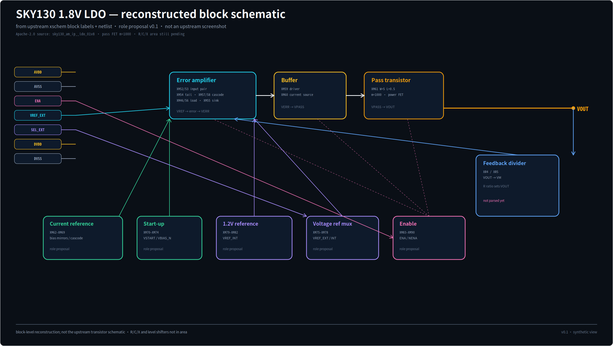

# Primary target: SKY130 1.8 V LDO

## Why replace the 10-MOS OP

The two-stage Miller OP is useful as a unit test, but it is too small to show the
agent's advantage:

- only 10 MOS;
- `C1_CC = 3 pF` at 2 fF/µm² is 1500 µm², which dominates a 10-MOS circuit and
  looks unreasonable for this topology;
- no power stage, no feedback divider, no startup, no level shifters, no
  hierarchy.

## Primary target

- IP: `sky130_am_ip__ldo_01v8`
- Source:
  [fossi-foundation/sky130_am_ip__ldo_01v8](https://github.com/fossi-foundation/sky130_am_ip__ldo_01v8)
- License: Apache-2.0
- Local copy: [`examples/sky130_ldo_01v8/ldo.sp`](../examples/sky130_ldo_01v8/ldo.sp)
- Annotated proposal: [`examples/sky130_ldo_01v8/ldo.annotated.sp`](../examples/sky130_ldo_01v8/ldo.annotated.sp)
- Run snapshot: [`docs/targets/sky130-ldo/`](targets/sky130-ldo/)
- Local license: [`examples/sky130_ldo_01v8/LICENSE`](../examples/sky130_ldo_01v8/LICENSE)

## Size / content

| Item | Value |
| --- | --- |
| MOS devices | 41 |
| Power pass device | `XM61`, `m=1000` |
| Feedback divider | `XR4/XR5` |
| Bias resistor | `XR6` |
| MIM caps | `XC1/XC3` |
| Enable / startup | `XM83–XM90`, `XM70–XM74` |
| Reference select | `XM75–XM78` |
| Level shifters | `x1/x2` |

## What it exposes

1. **Real netlist names are generic** (`XM46`, `XM52`, ...), so name-only role
   inference gives 41 unknowns. The agent must propose roles from topology and a
   human-approved annotation layer.
2. **Parser gaps**: `XR*`, `XC*`, and `x*` subcircuits are ignored; area is
   undercounted and no LDO-specific roles exist.
3. **Power stage**: the pass FET is a real power device; floorplan/white-line
   must handle current density, wide metal, ESD, and feedback routing.
4. **Control/analog mix**: enable, startup, reference select, level shifters —
   good test for role grouping and module boundaries.

## Reconstructed block schematic



上游仓库没有现成 PNG，只有
[`xschem/sky130_am_ip__ldo_01v8.sch`](https://github.com/fossi-foundation/sky130_am_ip__ldo_01v8/blob/main/xschem/sky130_am_ip__ldo_01v8.sch)。
这张图是**从 xschem block label + netlist 重建的 block schematic**，不是上游原始截图；
用来先审 role map，不是晶体管级 schematic。

## Current run

Raw netlist:

```text
Devices:  41 (41 MOS, 0 cap) in 41 groups
Unknown:  41
Block:    12203 µm² (undercount; R/C/X ignored)
```

Agent role proposal (`ldo.annotated.sp`):

```text
Devices:  41 (41 MOS, 0 cap) in 14 groups
Roles:    41 explicit overrides, 0 unknown
Block:    14649 µm²
Envelope: 15820 µm²
Gate:     PASS @ 30000 µm²
Dominant: output_stage (XM61 pass FET) 83.4%
```

This is a **proposal**, not analog-approved. `pass_device` is mapped to
`output_stage`; `startup` is mapped to `bias`; select is `adj_switch`.

## Floorplan finding

The pass FET is `W=5, L=0.5, m=1000`. Without folding, the floorplan becomes a
14k-pixel strip. A readability fold at 100 µm reduced it to ~94 µm per row, but
the 14 groups are still packed into 3 bands, so the block is still **605.6 µm
wide**. This is a floorplan-algorithm gap, not a device-rule result.

## Still to build

- `XR*` resistor and `XC*` MIM capacitor area;
- `x1/x2` level-shifter black-box area;
- better multi-row/multi-column floorplan for 14 groups;
- LDO white-line layout plan (pass FET, feedback divider, enable/startup, level
  shifters);
- LDO Layout Card and guideline.

## Why this matters

A real target with 41 MOS, power stage, feedback, enable, startup, and hierarchy
is a much better test of the agent than a 10-MOS OP. It also shows where the agent
must stop guessing and ask the analog owner for a role map.
