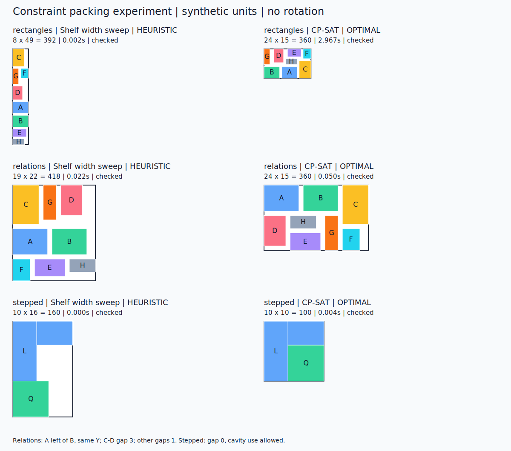

# AI 与约束求解协作：排布讨论、实验结果及接入建议

日期：2026-11-08。状态：**讨论总结 + 已完成的合成实验；项目接入仍为建议**。

## 1. 问题定义

本阶段的对象是图形、框及其规则，不要求 GDS 或版图应用。
给定各对象的尺寸/形状、可选形态和相互关系，寻找满足全部硬规则、外框面积尽可能小的排列。
固定图形面积之和不随坐标变化；真正优化的是外框 W×H，或明确指定的模块/整体外框。

前期评估过 KLayout、GLayout、MCP 等工具，但用户澄清当前重点是通用约束排布。
因此本次试验集中于 OR-Tools CP-SAT，不以 EDA 应用集成为前提。

## 2. AI、算法和人的职责

```text
设计者提出目标与规则
  → AI 整理图形、约束、自由度及待确认问题
  → 生成允许的 bank 形态
  → 算法求解位置、形态选择和外框
  → 独立程序复核规则 + AI 检查设计意图与图像
  → 修改输入后再次求解
  → 人工验收并冻结
```

| 层次 | 需要定义 | 可交给算法的自由度 |
| --- | --- | --- |
| bank 内部 | 成员、匹配、方向、dummy、间距及允许行列 | 仅选择允许的排列和形态 |
| bank 之间 | 相对位置、对齐、对称、隔离、预留和旋转许可 | 坐标、允许方向、外框 |

- 硬规则必须满足，不能为了缩小面积静默放松。
- 优化偏好如更方、更近，应与硬规则分开；优先明确主目标，再考虑次目标。
- AI 微调应写回输入、约束或形态候选，重新求解/检查，不能只修图片。
- 冻结 bank 的内部不可被上层装配改写；必要变更返回上游，创建新版本并验收。
- 程序验证已编码规则，AI 检查语义遗漏，设计者确认工程目标；三者不能互相替代。
- 达到硬规则、面积/形状目标并经人工确认即可停止，不必每次追求全局最优证明。

## 3. 算法表达

矩形使用整数坐标 x/y 与固定宽高，NoOverlap2D 表达不重叠。
方向分离不等式可表达间距、左右关系；坐标等式表达对齐和固定相对偏移。
直角阶梯形可拆成不相交矩形，用同一个组坐标保持刚性。

必须区别实际占用区域、外接矩形和 keepout。只用外接矩形可能浪费凹口；允许利用凹口也必须有规则依据。
共享 ring、特殊接触或允许重叠不能套用全对象无条件不重叠，需另行建模。

CP-SAT 使用整数域。应定义坐标网格及精确转换方法，避免浮点截断缩小间距。
FEASIBLE 是合法候选，OPTIMAL 是当前模型及求解精度设置下达到最优；UNKNOWN 不是无解。
结果必须记录范围、目标、状态、下界和耗时。证明只覆盖已经编码的规则。

## 4. 已完成的简单实验

实验 11 月 7 日准备，11 月 8 日完成。版本 OR-Tools 9.15.6755，单线程、seed=0。
全部参数是无工艺含义的合成整数；没有使用 LDO 草稿，也没有改变任何 bank。

基线为独立实现的 first-fit shelf：扫描候选整数宽度，比较输入顺序/高度排序，
包含纵向间距，过滤违反规则的结果。它不是原项目旧脚本的直接跑分。
CP-SAT 使用相同输入及规则，以上述合法解作上界和提示；外框宽高上限均为 100。
每例各运行 1 秒、5 秒预算一次。耗时仅含 solve 调用，不含导入、建模或绘图。

| 案例 | 基线面积 | CP-SAT 面积 | 减少 | 达到最优的实测耗时 |
| --- | ---: | ---: | ---: | ---: |
| 8 个固定矩形，间距 1 | 392 | 360 | 8.16% | 2.9671 秒 |
| 上例增加 A 在 B 左边且同 Y，C/D 间距 3 | 418 | 360 | 13.88% | 0.0502 秒 |
| L 形与矩形，间距 0，允许利用凹口 | 160 | 100 | 37.50% | 0.0036 秒 |



普通矩形在 1 秒内找到面积 360 的 FEASIBLE 解；5 秒预算的另一次运行在约 2.97 秒完成最优证明。
所有有效结果通过独立坐标检查；三个重叠篡改负例被识别，三个 2×2 外框负例返回 INFEASIBLE。

**不能据此推断：**

- CP-SAT 比 shelf 更快：本例 shelf 是毫秒级，求解器用更多时间换更好结果及证明。
- 真实 LDO 也能改善上述比例：没有运行真实项目实例。
- 阶梯形的 37.5% 是对同等形状能力算法的胜出：基线只用外接矩形，该例主要说明形状表达的重要性。
- 约束越多越快：关系案例更快仅是单个实例的观察。
- 已覆盖全部规则：尚未测试旋转、共享 ring、可变行列、连线或大规模实例；每档只测一次。

证据：[原始结果](experiments/2026-11-08-packing/results.json)、
[实验报告](experiments/2026-11-08-packing/RESULTS.md)、
[脚本](experiments/2026-11-08-packing/experiment.py)、
[依赖锁定](experiments/2026-11-08-packing/requirements-lock.txt)、
[文件哈希](experiments/2026-11-08-packing/sha256.txt)。
这些文件从独立实验目录逐字节复制，未为发布重跑并替换历史测量值。

## 5. 项目接入建议（尚未实施）

接入点是 [ARCHITECTURE.md](../ARCHITECTURE.md) 的 L5 装配层。
现有 [make_dnw1_assembly.py](../examples/sky130_ldo_01v8/make_dnw1_assembly.py) 的 shelf 摆放可以作为对照后端，
但需先校验规则：当前换行只累加行高，若 GAP 表示所有对象间距，则缺少跨行间距。

输入统一为对象 ID/版本、真实形状、外框、keepout、允许方向、组内偏移、间距/包含/对齐、网格及目标。
先解决以下现存输入问题，再消费真实宏块：

- PMOS_1X7_BANK 在 bank-specs 中外框为 11.68×12.20，在 bank-library 中为 12.94×11.51；需确定唯一几何来源。
- 已结构冻结的 XR_GROUP 是 40×17 阶梯形整体；旧装配脚本还从整体 manifest 读取独立 passive blocks。
- 旧 LDO 脚本尚未全面迁移到契约 API，不因存在 contracts.py 就认定冻结和单 writer 已落实。

建议的最小职责拆分（拟议文件，当前未新增）：

```text
a2l/layout/placement.py          输入输出契约
           packing_cp_sat.py    求解后端
           placement_checks.py  独立检查
```

先保留独立实验入口，成熟后再接 CLI；OR-Tools 作为可选依赖，核心继续可离线运行。
同时检查 setuptools 的子包发现（当前显式 packages=["a2l"]）。
渲染器只读取求解坐标，不另行布局。JSON 输出应带输入标识、规则/算法版本、目标值、下界、状态、耗时和验证结果。

近期顺序：输入迁移 → 统一几何/消除重复 writer → 少量确认图形试验 → 冻结宏块正式装配。
探索试验与正式装配分开，DNW1 当前暂停状态不变。

## 6. 复现与文档位置

在实验目录运行（依赖装在独立环境）：

```bash
cd docs/experiments/2026-11-08-packing
python3 -m venv /tmp/a2l-packing-repro
/tmp/a2l-packing-repro/bin/pip install -r requirements-lock.txt
/tmp/a2l-packing-repro/bin/python experiment.py
```

脚本会覆盖运行目录下 results.json/comparison.svg；保留发布测量时，应先复制实验目录到临时位置后运行。
PNG 是对保存的 SVG 使用 CairoSVG 栅格化后的人工检查预览，不由求解脚本自动输出。
实验依赖没有加入 pyproject.toml；重跑耗时和限时搜索路径可能变化。

工作区入口分工：AGENTS.md 管长期边界，CURRENT_TASK.md 管当前阶段，ARCHITECTURE/WORKFLOW 管层次与阶段门，
agent/prompts 管任务提示词，docs 管说明与实验。规则尽量引用唯一输入，避免在提示词、绘图代码和报告中分别复制。
本总结不新增 role、工艺值、匹配批准或正式装配基线。

## 7. 官方资料

- [OR-Tools 仓库](https://github.com/google/or-tools)，[Apache-2.0 许可证](https://github.com/google/or-tools/blob/stable/LICENSE)
- [CP-SAT 整数建模与状态说明](https://developers.google.com/optimization/cp/cp_solver)
- [CpModel API：NoOverlap2D、乘积与逻辑约束](https://or-tools.github.io/docs/python/classortools_1_1sat_1_1python_1_1cp__model_1_1CpModel.html)
- [官方二维填充示例](https://github.com/google/or-tools/blob/stable/examples/python/cover_rectangle_sat.py)

以上资料在讨论期间检索；项目适配方案是本工作区的评估建议，实测证据以上述独立脚本和结果为准。
