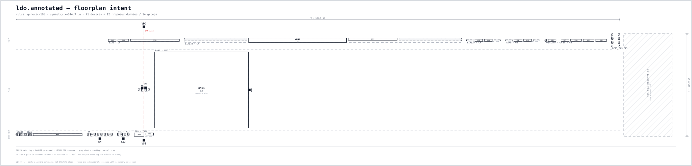

# Handoff — ldo.annotated

> Floorplan sketch intent generated from a role-annotated schematic. Use this as the agenda for the schematic/layout review, not as a signoff document.

## 1. Block summary

| Metric | Value |
| --- | ---: |
| Device core | 8028 µm² |
| Active area (+ ring/routing) | 10278 µm² |
| Matched area (+ dummy/matching) | 11534 µm² |
| **Block area** | **14649 µm²** |
| PEX-fix reserve | 1172 µm² |
| Total envelope | 15820 µm² |
| Dummy area | 1119 µm² |
| Estimate range | 11719 µm² – 19776 µm² |
| Area gate | **PASS** (budget 30000 µm²) |
| Shape | 605.6 × 104.0 µm; aspect 5.82; squareness 0.17; landscape |
| Arrangement | 3 rows (top/mid/bottom); groups/band: top=8, mid=2, bottom=4; symmetry axis at x=144.3 um |
| Devices / groups | 41 / 14 |
| Rules | `generic-180` (educational); owner: analog design engineer |
| Width convention | `per_finger` |
| Role sources | name 0, explicit override 41, unknown 0 |

> Area hierarchy: **core** (OD/cap) < **active** (+guard ring/routing) < **matched** (+dummy/matching) < **block** (+periphery) < **envelope** (+reserve).

## 2. What layout must preserve

- Input pair: symmetry, common-centroid/interdigitated pattern, clean gate routing, substrate isolation.
- Current mirror / tail: identical environment for all ratio devices; boundary dummies as proposed.
- Cascode stack: source-drain routing kept short; dummy stack at the boundary if proposed.
- Output stage: current density, wide metal, multiple vias, EM/IR review.
- Reserve the hatched PEX-fix strip; do not consume it for unrelated routing.

## 3. Groups and devices

| Group | Role | Devices | Match | Layout intent | Area |
| --- | --- | --- | --- | --- | ---: |
| `PASS` | output_stage | `XM61` | `—` | — | 8567 µm² |
| `BIAS_N` | current_mirror | `XM66`, `XM67` | `BIAS_N` | interdigitated | 1929 µm² |
| `BIAS` | current_mirror | `XM48`, `XM68`, `XM69` | `—` | — | 245 µm² |
| `BIAS_P` | current_mirror | `XM62`, `XM64` | `BIAS_P` | interdigitated | 146 µm² |
| `LOAD` | current_mirror | `XM46`, `XM56` | `LOAD` | interdigitated | 146 µm² |
| `START` | bias | `XM70`, `XM71`, `XM72`, `XM73`, `XM74` | `—` | — | 104 µm² |
| `REF` | current_mirror | `XM79`, `XM80`, `XM81`, `XM82` | `—` | — | 92 µm² |
| `ERR` | tail_current | `XM54`, `XM55` | `—` | — | 83 µm² |
| `ERR_DP` | input_pair | `XM52`, `XM53` | `ERR_DP` | common_centroid | 63 µm² |
| `BIAS_C` | cascode | `XM63`, `XM65` | `BIAS_C` | stacked | 45 µm² |
| `CAS` | cascode | `XM57`, `XM58` | `CAS` | stacked | 45 µm² |
| `PASS_DRV` | current_mirror | `XM59`, `XM60` | `—` | — | 37 µm² |
| `EN` | enable_switch | `XM83`, `XM84`, `XM85`, `XM86`, `XM87`, `XM88`, `XM89`, `XM90` | `—` | — | 21 µm² |
| `SEL` | adj_switch | `XM75`, `XM76`, `XM77`, `XM78` | `—` | — | 12 µm² |

## 4. Proposed layout-induced schematic deltas

These are the predictable changes that otherwise show up late in PEX. Accept or reject each item **before** the layout is frozen.

> **Reserve check:** proposed deltas total 3440 µm², but the PEX-fix reserve is 1172 µm² — shortfall 2269 µm². Increase the reserve or reduce/relocate deltas before freezing the floorplan.

| ID | Kind | Target | Action | Owner | Area impact | Status |
| --- | --- | --- | --- | --- | ---: | --- |
| `D001` | routing_intent | PASS (XM61) | Reserve wide metal / multiple vias for the output devices | layout | 0 µm² | proposed |
| `D002` | dummy | BIAS_N (XM66, XM67) | Add 2 boundary dummy device(s); see the dashed DM blocks in the floorplan | layout | 910 µm² | proposed |
| `D003` | dummy_logic | BIAS_N (XM66, XM67) | Add a dummy mirror branch / dummy stack next to the mirror | analog | 0 µm² | proposed |
| `D004` | dummy_logic | BIAS (XM48, XM68, XM69) | Add a dummy mirror branch / dummy stack next to the mirror | analog | 0 µm² | proposed |
| `D005` | dummy | BIAS_P (XM62, XM64) | Add 2 boundary dummy device(s); see the dashed DM blocks in the floorplan | layout | 69 µm² | proposed |
| `D006` | dummy_logic | BIAS_P (XM62, XM64) | Add a dummy mirror branch / dummy stack next to the mirror | analog | 0 µm² | proposed |
| `D007` | dummy | LOAD (XM46, XM56) | Add 2 boundary dummy device(s); see the dashed DM blocks in the floorplan | layout | 69 µm² | proposed |
| `D008` | dummy_logic | LOAD (XM46, XM56) | Add a dummy mirror branch / dummy stack next to the mirror | analog | 0 µm² | proposed |
| `D009` | dummy_logic | REF (XM79, XM80, XM81, XM82) | Add a dummy mirror branch / dummy stack next to the mirror | analog | 0 µm² | proposed |
| `D010` | dummy_logic | ERR (XM54, XM55) | Add a dummy tail device on the unused side of the tail current source | analog | 0 µm² | proposed |
| `D011` | dummy | ERR_DP (XM52, XM53) | Add 2 boundary dummy device(s); see the dashed DM blocks in the floorplan | layout | 28 µm² | proposed |
| `D012` | guard_ring | ERR_DP (XM52, XM53) | Place a guard ring and keep the pair on a common-centroid / interdigitated pattern | layout | 17 µm² | proposed |
| `D013` | routing_intent | ERR_DP (XM52, XM53) | Keep input gate routing symmetric and shielded; reserve a clean channel to the pair | both | 0 µm² | proposed |
| `D014` | dummy | BIAS_C (XM63, XM65) | Add 2 boundary dummy device(s); see the dashed DM blocks in the floorplan | layout | 21 µm² | proposed |
| `D015` | dummy_logic | BIAS_C (XM63, XM65) | Add a dummy cascode device at the top/bottom of the stack | both | 0 µm² | proposed |
| `D016` | dummy | CAS (XM57, XM58) | Add 2 boundary dummy device(s); see the dashed DM blocks in the floorplan | layout | 21 µm² | proposed |
| `D017` | dummy_logic | CAS (XM57, XM58) | Add a dummy cascode device at the top/bottom of the stack | both | 0 µm² | proposed |
| `D018` | dummy_logic | PASS_DRV (XM59, XM60) | Add a dummy mirror branch / dummy stack next to the mirror | analog | 0 µm² | proposed |
| `D019` | dummy_logic | EN (XM83, XM84, XM85, XM86, XM87, XM88, XM89, XM90) | Add a dummy switch (same W/L, gate tied off) next to the switch | analog | 21 µm² | proposed |
| `D020` | dummy_logic | SEL (XM75, XM76, XM77, XM78) | Add a dummy switch (same W/L, gate tied off) next to the switch | analog | 12 µm² | proposed |
| `D021` | decap | vdd/vss | Add a 2.00 pF decap between VDD and VSS near the block | both | 1100 µm² | proposed |
| `D022` | reserve | block | Keep 8% of the block area as an uncommitted PEX-fix reserve | both | 1172 µm² | proposed |

## 5. PEX re-simulation scope

- DC offset / input-referred noise after input-pair and tail routing parasitics
- AC gain / phase margin after current-mirror parasitic extraction
- AC gain / phase margin after cascode-stack parasitic extraction
- Large-signal swing / EM and IR-drop check after output routing
- Post-layout DC operating point after dummy, decap and guard-ring insertion

## 6. Review questions

- Are the role annotations complete and correct, especially for switches and dummies?
- Is the input-pair symmetry axis where the designer expects it?
- Are the proposed boundary dummies and dummy branches wanted, or should they be removed?
- Is the decap value / location acceptable, or should it be split between supplies?
- Does the reserved PEX-fix area match the team's risk tolerance for this block?
- The block is elongated (aspect 5.82, squareness 0.17); is this shape compatible with the parent block and the intended pin locations?

## 7. Warnings

- XM54: role tail_current needs a match group; add match= or give the instance a semantic name token
- XM60: role current_mirror needs a match group; add match= or give the instance a semantic name token
- XM68: role current_mirror needs a match group; add match= or give the instance a semantic name token
- XM69: role current_mirror needs a match group; add match= or give the instance a semantic name token
- XM79: role current_mirror needs a match group; add match= or give the instance a semantic name token
