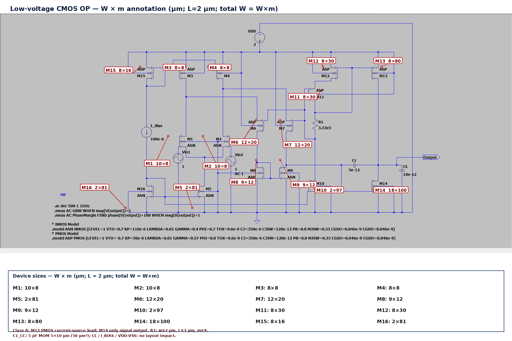
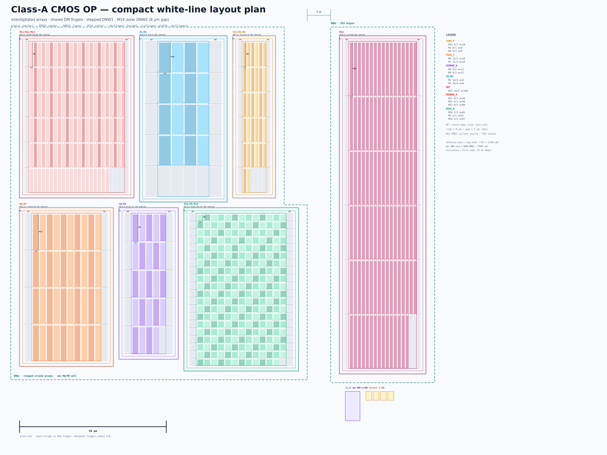
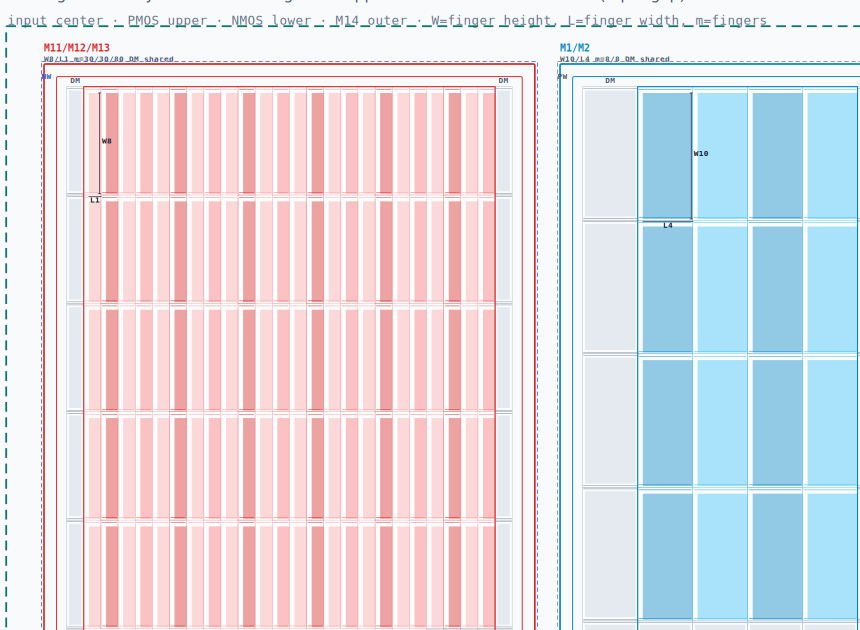

# Low-voltage class-A CMOS op-amp — corrected review target

A real transistor-level schematic + netlist for role-map review.

> **Correction:** the upstream README calls this a class-AB design, but the
> netlist is **class A**: M13's gate is a bias node, only M14's gate is
> signal-driven. M13 is a PMOS current-source load, not a push-pull output device.
> The folder was renamed from `classab_opamp` to `classa_opamp`.

## Source

- Upstream:
  [Amirhossein7717/low-voltage-cmos-opamp](https://github.com/Amirhossein7717/low-voltage-cmos-opamp)
- Design: two-stage CMOS op-amp, 2 V supply, 0.8 µm Level=1 models
- License: MIT (see `LICENSE`)
- Original netlist: `src/AHLowVoltageOpAmp.net`
- Original schematic: [`schematic.png`](schematic.png)

## Annotated schematic



All dimensions are **W/L in µm**; `m` is the parallel multiplicity; total W = W × m.

| Device | W/L (µm) | m | total W | Device | W/L (µm) | m | total W |
| --- | --- | ---: | ---: | --- | --- | ---: | ---: |
| M1 | 10/4 | 8 | 80 | M2 | 10/4 | 8 | 80 |
| M3 | 8/1 | 8 | 64 | M4 | 8/1 | 8 | 64 |
| M5 | 2/2 | 81 | 162 | M6 | 12/2 | 20 | 240 |
| M7 | 12/2 | 20 | 240 | M8 | 9/2 | 12 | 108 |
| M9 | 9/2 | 12 | 108 | M10 | 2/2 | 97 | 194 |
| M11 | 8/1 | 30 | 240 | M12 | 8/1 | 30 | 240 |
| M13 | 8/1 | 80 | 640 | M14 | 18/1 | 100 | 1800 |
| M15 | 8/1 | 16 | 128 | M16 | 2/2 | 81 | 162 |

## White-line layout plan



This version uses flexible array rows and a compact two-row main placement:

- rows are chosen to make the two main rows nearly equal height;
- current rows: LOAD 6, FOLD 4, MIRROR_N 5, IN 5, MIRROR_P 6, BIAS 20, OUT 6;
- gate pitch is **L + 0.36 µm** for `sd_mode=shared`;
- ring gap **0.8 µm**, group gap **2 µm**;
- dummies use the same finger geometry as active devices; only the external
  `DM` label differs;
- no `FILL DM` blocks and no fake dummy fill;
- DNW1 is a stepped outline; M14 is in DNW2 at the outer right, 8 µm away;
- input pair in the center row; PMOS upper, NMOS lower;
- C1/R1 are placed **between DNW1 and DNW2**, and their area is counted.

Approximate area accounting (inside-ring effective area + R/C, divided by the
DNW1+DNW2 outer area):

```text
ring-inner effective area ≈ 11,690 µm²
C1 + R1                    ≈     74 µm²
effective total            ≈ 11,764 µm²
DNW1 + DNW2 outer          ≈ 15,965 µm²
utilization                ≈ 73.7%
```

If the denominator is the total outer bounding box including the 8 µm DNW gap and
C1/R1, utilization is about **67.7%**.

If “inside ring” includes the ring metal itself, the number is about **81.6%**.

Detail crop:



Source: [white-line.svg](white-line.svg) · generator: [make_white_line.py](make_white_line.py).

## What the netlist actually is

- **16 MOS** + one compensation cap (`C1_CC = 5 pF`);
- input pair `M1/M2`;
- PMOS current-source loads `M3/M4`;
- second stage `M6/M7` (PMOS common-gate) + `M8/M9` (NMOS mirror load);
- bias `M10/M15/M16`;
- `M11/M12/R1` form a **PMOS bias current source** that sets M13's gate `n003`;
- **M13 is a PMOS current-source load** (`gate n003 = bias`);
- **M14 is the only signal-driven output device** (`gate n012`);
- output stage is therefore **class A**, not class-AB push-pull.

The earlier explanation that called M13/M14 a class-AB push-pull pair was wrong.
The key check is simple: **M13's gate has no signal path**; it is tied to
`n003`, which is set by `M11/M12/R1`, not by `n012` or the first stage.

## Why this review target

- Has an actual schematic image and a netlist, so the user can judge the role map.
- 16 MOS is larger than the 10-MOS Miller OP, but still small enough to trace.
- Exposes a real documentation/verification issue: the upstream README's
  "class AB" label does not match the netlist.
- No enable / no feedback divider / no level shifters; focused role review.

## Current netlist

- 16 MOS + 1 compensation cap.
- `C1_CC = 5 pF` MOM, fixed **5 × 10 µm = 50 µm²** layout block; see [cap-mom-5x10.png](cap-mom-5x10.png).
- `R1 = 3.33 kΩ`, `w=2 µm`, `L=3 µm`, `m=4`; the parser currently ignores R.
- `I_BIAS = 100 µA` is an ideal source: **no layout impact**.
- External `CL = 10 pF` is a testbench load: **no layout impact**.
- `VDD/VSS = 2 V / 0 V` are supplies: **no layout impact**.

```bash
python3 -m a2l analyze examples/classa_opamp/opamp.sp
python3 -m a2l analyze examples/classa_opamp/opamp.sized.sp
```

- `opamp.sp`: original total-W values.
- `opamp.sized.sp`: the same topology with unit `w=...` and `m=...` from
  [sizing.md](sizing.md); total W is preserved (M8/M9 changed 109→108).

## Documents

- [sizing.md](sizing.md): unit W, m conversion, matching-group ratios, C1_CC fixed MOM block.

- [structure.md](structure.md): node-by-node explanation, corrected to class A.
- [textbook.md](textbook.md): what Allen & Holberg say about class AB, and why
  this circuit is not it.

## What to judge

- Which devices belong to `input_pair`, `current_mirror`, `output_stage`,
  `bias`, `compensation`?
- Is M13 `bias` / `current_mirror` rather than `output_stage`?
- Is M14 the only `output_stage` device?
- Which groups need match/dummy/ring?
