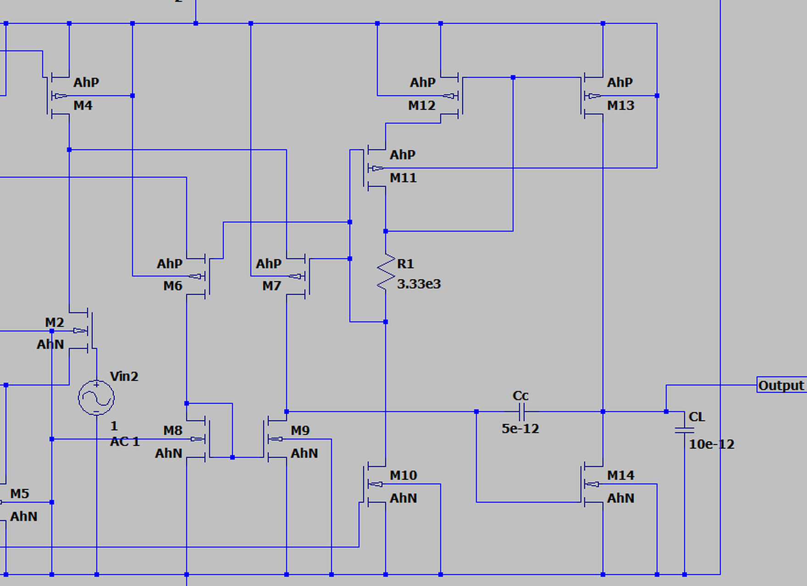

# M6/M7/R1/M11/M12/M13 的结构



这是上游 schematic 的局部放大；完整图见 [schematic.png](schematic.png)，网表见
[opamp.sp](opamp.sp)。

## 先看节点

| 节点 | 作用 |
| --- | --- |
| `n007`, `n005` | 第一级差分输出（M1/M2 的漏极） |
| `n006` | M6/M7/M11 的 PMOS 栅偏置 |
| `n011` | M6/M8 支路的中间节点；M8 的二极管连接点 |
| `n012` | 第二级单端输出；M14 的栅极；Cc 的一端 |
| `n003` | M11 漏极、M12/M13 栅极、R1 上端 |
| `n004` | M11 源极、M12 漏极（floating node） |
| `VOUT` | M13/M14 漏极相连的输出 |

## 1. M6/M7：第二级的 common-gate 输入

```text
n007 ── M6(PMOS) ── n011 ── M8(NMOS diode) ── VSS
n005 ── M7(PMOS) ── n012 ── M9(NMOS mirror) ── VSS
```

- M6/M7 的 **栅极都接 n006**，不是信号输入；
- 信号从它们的 **源极 n007/n005** 进来，所以是 **PMOS common-gate**；
- 第一级差分输出驱动 M6/M7 的源极，改变它们的 VGS/电流；
- M8 是二极管连接，M9 镜像 M8；M6/M8 和 M7/M9 两支路的电流差在 n012 汇总；
- 所以 M6/M7/M8/M9 把第一级差分信号转成 **n012 的单端信号**。

M6/M7 的源极不在固定电源上，而是跟着第一级输出浮动，所以这里也常被称为
class-AB 的 floating source / gain 部分。

## 2. M10：n006 的偏置电流源

```text
n006 ── M10(NMOS) ── VSS
```

- M10 的栅极接 `ibias`，源极 VSS，漏极 n006；
- 它从 n006 拉电流，设定 M6/M7/M11 的栅偏置；
- 它不直接传送信号，主要是 class-AB 偏置电流的一部分。

## 3. M11/M12/R1：floating current source

```text
VDD ── M12(PMOS) ── n004 ── M11(PMOS) ── n003
                              │ gate n006
n003 ── R1(3.33 kΩ) ── n006
```

连接关系：

- M12：源极 VDD，漏极 n004，栅极 n003；
- M11：源极 n004，漏极 n003，栅极 n006；
- R1 跨在 n003 和 n006 之间；
- n004 没有直接接电源/地，是 floating node。

关键电流关系：

```text
I_M12 = I_M11          （n004 节点 KCL，忽略栅极电流）
I_M11 = I_R1           （n003 节点 KCL）
I_R1  = (V(n003) - V(n006)) / R1
```

所以 R1 上的压降决定 M11/M12 支路电流；这个电流再被 M13 镜像出去。
这不是一个简单的“M12 二极管 + M11 镜像”，而是靠 M11/R1 的反馈把
n003/n006 调到正确的工作点。它的作用是给 class-AB 输出级提供一个
**浮动的偏置电流源**。

## 4. M13：PMOS 输出拉高

```text
VDD ── M13(PMOS) ── VOUT
        gate n003
```

- M13 的栅极接 n003，和 M12 的栅极同电位；
- 因此 M13 镜像 M12 的电流；
- M13 的 W/L 是 640/2，M12 是 240/2，比例约 2.67；
- M13 是 class-AB 输出级的 **pull-up** 器件。

## 5. M14：NMOS 输出拉低

```text
VOUT ── M14(NMOS) ── VSS
        gate n012
```

- M14 的栅极是 n012，也就是第二级单端输出；
- M14 是 class-AB 输出级的 **pull-down** 器件；
- M14 的 W/L 是 1800/2，明显大于 M13，用来补偿 NMOS 迁移率较低，
  并提供下拉电流。

M13 和 M14 的漏极都接 VOUT，形成 **push-pull class-AB**：

- 静态时两者都微微导通，静态电流由 M11/M12/R1 和 M8/M9 的偏置决定；
- 信号让 n003 和 n012 向相反方向变化，一边电流增大，另一边减小；
- 因此静态电流可以做小，但大信号时能向负载提供大电流。

## 6. Cc 和 R1 的关系

网表连接是：

```text
Cc:  VOUT ── n012   5 pF
R1:  n003 ── n006   3.33 kΩ
```

所以：

- `Cc` 是跨在输出级（M14 的栅-漏）上的 Miller 补偿电容；
- `R1` **不在 Cc 的串联支路里**；它在 class-AB 浮动电流源环路里。

上游 README 把 R1 描述成 “zero-cancellation resistor ≈ 1/gm6”，但按实际网表，
R1 首先是一个 class-AB 偏置电阻；它是否还通过这个环路引入/抵消零点，需要
对照报告和仿真确认。**不要把 R1 当成和 Cc 串联的 nulling resistor。**

## 一句话总结

- **M6/M7**：PMOS common-gate 第二级，把第一级差分输出变成电流；
- **M8/M9**：NMOS 镜像负载，把差分电流合成到 n012；
- **M10**：n006 的偏置电流源；
- **M11/M12/R1**：floating class-AB 偏置电流源，R1 设定电流；
- **M13/M14**：PMOS/NMOS push-pull 输出级；
- **Cc**：VOUT 到 n012 的 Miller 补偿；**R1 不在 Cc 串联支路**。

参考：上游 README 明确说这是基于 Allen & Holberg *CMOS Analog Circuit Design*
Fig. 7.6-17 的 class-AB 输出级；本页按网表连接解释，和 README 的 R1 说法有
一处需要核对的差异。
