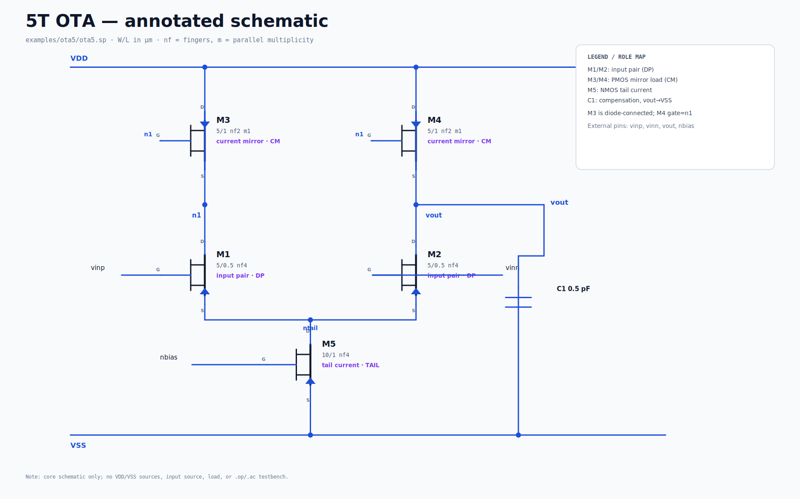

# ota5 — minimal example




A five-transistor OTA: input pair, current-mirror load, tail current and a
compensation cap. Good starting point for a new annotation/rule experiment.

```bash
python3 -m a2l build examples/ota5/ota5.sp --out out/ota5
```

It is also used as the baseline in:

```bash
python3 -m a2l compare examples/ota5/ota5.sp examples/ota5_cascode/ota5_cascode.sp
```

The nominal area is dominated by the 0.5 pF compensation cap under the generic
1.5 fF/µm² density. Replace the rule pack before drawing conclusions about a
real process.
