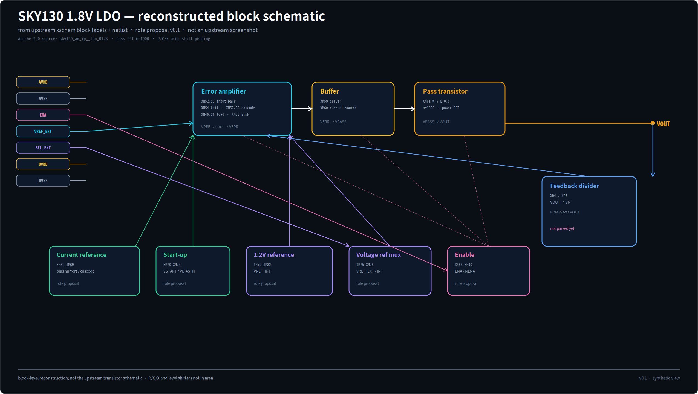

# SKY130 1.8 V LDO — candidate real target

A real, flat, transistor-level LDO from the Efabless/CHIPALOOZA open-source IP
family. This is a **candidate** for the next main target; the small OP remains a
unit test.

## Files and status

| Path | Role | Status |
| --- | --- | --- |
| [`ldo.sp`](ldo.sp) | raw SKY130 LDO netlist | read-only source |
| [`ldo.annotated.sp`](ldo.annotated.sp) | earlier A2L role proposal | retained for comparison |
| [`netlistlabel-overlay/`](netlistlabel-overlay/README.md) | NetlistLabel v0.2 semantic overlay | imported proposal; sampled human review |
| [`white-line-input.json`](white-line-input.json) | white-line geometry contract generated from the overlay | built; unknowns visible |
| [`make_white_line_input.py`](make_white_line_input.py) | deterministic overlay → JSON importer | reproducible |

The imported overlay is the preferred semantic input for the next LDO
white-line/area case. It preserves the raw netlist, records source commit and
hashes, and keeps the review status visible.

The generated [`white-line-input.json`](white-line-input.json) contains:

- 41 MOS, 5 passives, 2 level-shifter black boxes, 9 groups;
- `sd_mode=shared` for every MOS (user-confirmed, including `XM61`);
- `XC3`/`XR6` marked `user_confirmed`; `XC3` is VREF input filter (role decap),
  `XR6` is source degeneration for XM66;
- `x1/x2` are 5×5 cell+ring placeholders (`footprint_um2=25`,
  `status=estimated`), inside DNW1;
- `XR4/XR5/XR6` are square folded resistor blocks with boundary dummy cells;
  each 10×0.35 µm segment is folded into a 2×2 µm cell, not placed as a thin strip;
- DNW1 contains everything except XM61; DNW2 contains XM61 + guard ring;
- `output_outer` is a **soft preference** tied to LDO current/pass-device floorplan;
- the overlay's `PROPOSAL, NOT APPROVED` and sampled-review status are preserved.

Regenerate it with:

```bash
python3 examples/sky130_ldo_01v8/make_white_line_input.py
python3 -m unittest tests.test_ldo_white_line_input -q
```

## Source

- Upstream:
  [fossi-foundation/sky130_am_ip__ldo_01v8](https://github.com/fossi-foundation/sky130_am_ip__ldo_01v8)
- Original: `sky130_am_ip__ldo_01v8`, low-power 1.8 V LDO
- License: Apache-2.0 (see `LICENSE`)
- Netlist copied from `netlist/schematic/sky130_am_ip__ldo_01v8.spice`

## Schematic view



Upstream has no PNG screenshot; it has an xschem `.sch`. This block schematic is
reconstructed from the block labels + netlist for role-map review, not a
transistor-level screenshot.

## Why this is a better target

- **41 MOS** plus one power pass device with `m=1000` (`XM61`);
- real feedback divider (`XR4/XR5`), bias resistor (`XR6`), MIM caps (`XC1/XC3`);
- enable, startup, bias generation, reference select, external-reference select;
- two level-shifter subcircuits (`x1/x2`);
- 5 V devices, 1.8 V devices, power stage, feedback loop: much more representative
  than a 10-MOS two-stage OP.

## Current parser result

Raw netlist:

```text
Devices: 41 (41 MOS, 0 cap) in 41 groups
Role sources: name 0, explicit 0, unknown 41
Block: 12203 µm² (undercount: R, MIM C, X subcircuits ignored)
```

Agent role proposal: [`ldo.annotated.sp`](ldo.annotated.sp)

```text
Devices: 41 (41 MOS, 0 cap) in 14 groups
Role sources: explicit 41, unknown 0
Block: 14649 µm²
Gate: PASS @ 30000 µm²
Pass FET XM61: 83.4% of device area
```

The role map is **proposed by the agent from topology**, not approved by the
analog owner. `pass_device` is mapped to `output_stage` for now.

## Run

```bash
python3 -m a2l analyze examples/sky130_ldo_01v8/ldo.annotated.sp
python3 -m a2l validate examples/sky130_ldo_01v8/ldo.annotated.sp --require-known-roles
python3 -m a2l build examples/sky130_ldo_01v8/ldo.annotated.sp --out out/sky130_ldo --area-budget-mm2 0.03 --fail-on-gate
```

## Known gaps

- `XR*` resistors ignored;
- `XC*` MIM capacitors ignored;
- `x1/x2` level shifters ignored;
- role taxonomy has no `pass_device` (could map to `output_stage` or add a new role
  with analog-owner approval);
- raw netlist: all 41 MOS `unknown`; older annotated proposal: 41 explicit, still needs analog review.
- NetlistLabel overlay: 41/41 MOS roles proposed; sampled review accepted 44 device + 6 net + 8 port, but full net/passive review is still incomplete. See [`netlistlabel-overlay/`](netlistlabel-overlay/README.md).
