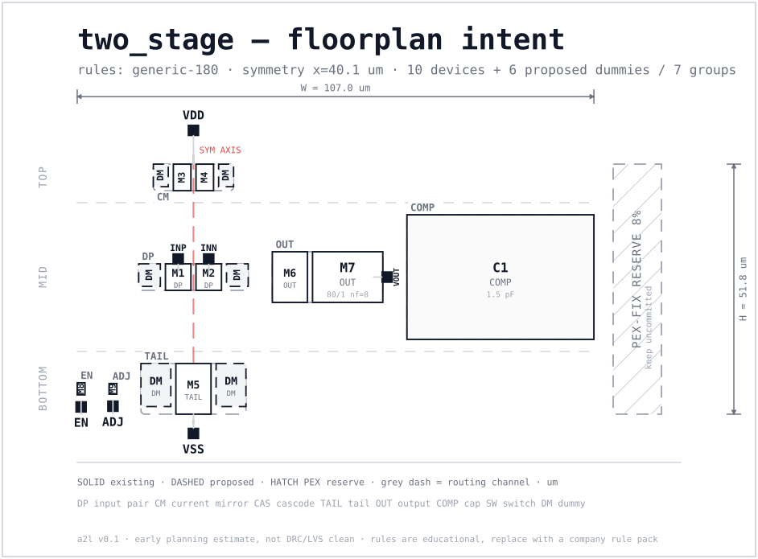

# Handoff — two_stage

> Floorplan sketch intent generated from a role-annotated schematic. Use this as the agenda for the schematic/layout review, not as a signoff document.

## 1. Block summary

| Metric | Value |
| --- | ---: |
| Device core | 1409 µm² |
| Active area (+ ring/routing) | 1707 µm² |
| Matched area (+ dummy/matching) | 2247 µm² |
| **Block area** | **3377 µm²** |
| PEX-fix reserve | 270 µm² |
| Total envelope | 3647 µm² |
| Dummy area | 457 µm² |
| Estimate range | 2701 µm² – 4558 µm² |
| Area gate | **PASS** (budget 5000 µm²) |
| Shape | 109.7 × 51.8 µm; aspect 2.12; squareness 0.47; landscape |
| Arrangement | 3 rows (top/mid/bottom); groups/band: top=1, mid=3, bottom=3; symmetry axis at x=40.8 um |
| Devices / groups | 10 / 7 |
| Rules | `generic-180` (educational); owner: analog design engineer |
| Width convention | `per_finger` |
| Role sources | name 0, explicit override 10, unknown 0 |

> Area hierarchy: **core** (OD/cap) < **active** (+guard ring/routing) < **matched** (+dummy/matching) < **block** (+periphery) < **envelope** (+reserve).

## 2. What layout must preserve

- Input pair: symmetry, common-centroid/interdigitated pattern, clean gate routing, substrate isolation.
- Current mirror / tail: identical environment for all ratio devices; boundary dummies as proposed.
- Cascode stack: source-drain routing kept short; dummy stack at the boundary if proposed.
- Output stage: current density, wide metal, multiple vias, EM/IR review.
- Reserve the hatched PEX-fix strip; do not consume it for unrelated routing.

## 3. Groups and devices

| Group | Role | Devices | Match | Layout intent | Area |
| --- | --- | --- | --- | --- | ---: |
| `COMP` | compensation | `C1` | `—` | — | 1100 µm² |
| `TAIL` | tail_current | `M5` | `TAIL` | common_centroid | 426 µm² |
| `OUT` | output_stage | `M6`, `M7` | `—` | interdigitated | 271 µm² |
| `DP` | input_pair | `M1`, `M2` | `DP` | common_centroid | 258 µm² |
| `CM` | current_mirror | `M3`, `M4` | `CM` | interdigitated | 186 µm² |
| `EN` | enable_switch | `M8` | `—` | minimal | 4 µm² |
| `ADJ` | adj_switch | `M9` | `—` | minimal | 2 µm² |

## 4. Proposed layout-induced schematic deltas

These are the predictable changes that otherwise show up late in PEX. Accept or reject each item **before** the layout is frozen.

> **Reserve check:** proposed deltas total 2239 µm², but the PEX-fix reserve is 270 µm² — shortfall 1969 µm². Increase the reserve or reduce/relocate deltas before freezing the floorplan.

| ID | Kind | Target | Action | Owner | Area impact | Status |
| --- | --- | --- | --- | --- | ---: | --- |
| `D001` | dummy | TAIL (M5) | Add 2 boundary dummy device(s); see the dashed DM blocks in the floorplan | layout | 254 µm² | proposed |
| `D002` | dummy_logic | TAIL (M5) | Add a dummy tail device on the unused side of the tail current source | analog | 0 µm² | proposed |
| `D003` | routing_intent | OUT (M6, M7) | Reserve wide metal / multiple vias for the output devices | layout | 0 µm² | proposed |
| `D004` | dummy | DP (M1, M2) | Add 2 boundary dummy device(s); see the dashed DM blocks in the floorplan | layout | 115 µm² | proposed |
| `D005` | guard_ring | DP (M1, M2) | Place a guard ring and keep the pair on a common-centroid / interdigitated pattern | layout | 40 µm² | proposed |
| `D006` | routing_intent | DP (M1, M2) | Keep input gate routing symmetric and shielded; reserve a clean channel to the pair | both | 0 µm² | proposed |
| `D007` | dummy | CM (M3, M4) | Add 2 boundary dummy device(s); see the dashed DM blocks in the floorplan | layout | 88 µm² | proposed |
| `D008` | dummy_logic | CM (M3, M4) | Add a dummy mirror branch / dummy stack next to the mirror | analog | 0 µm² | proposed |
| `D009` | dummy_logic | EN (M8) | Add a dummy switch (same W/L, gate tied off) next to the switch | analog | 4 µm² | proposed |
| `D010` | dummy_logic | ADJ (M9) | Add a dummy switch (same W/L, gate tied off) next to the switch | analog | 2 µm² | proposed |
| `D011` | decap | vdd/vss | Add a 2.00 pF decap between VDD and VSS near the block | both | 1467 µm² | proposed |
| `D012` | reserve | block | Keep 8% of the block area as an uncommitted PEX-fix reserve | both | 270 µm² | proposed |

## 5. PEX re-simulation scope

- DC offset / input-referred noise after input-pair and tail routing parasitics
- AC gain / phase margin after current-mirror parasitic extraction
- Stability (loop gain / phase margin) after Cc and output-node parasitics
- Large-signal swing / EM and IR-drop check after output routing
- Post-layout DC operating point after dummy, decap and guard-ring insertion

## 6. Review questions

- Are the role annotations complete and correct, especially for switches and dummies?
- Is the input-pair symmetry axis where the designer expects it?
- Are the proposed boundary dummies and dummy branches wanted, or should they be removed?
- Is the decap value / location acceptable, or should it be split between supplies?
- Does the reserved PEX-fix area match the team's risk tolerance for this block?
- The block is elongated (aspect 2.12, squareness 0.47); is this shape compatible with the parent block and the intended pin locations?

## 7. Warnings

- match group 'TAIL' has only one device; matching assumptions are weak
