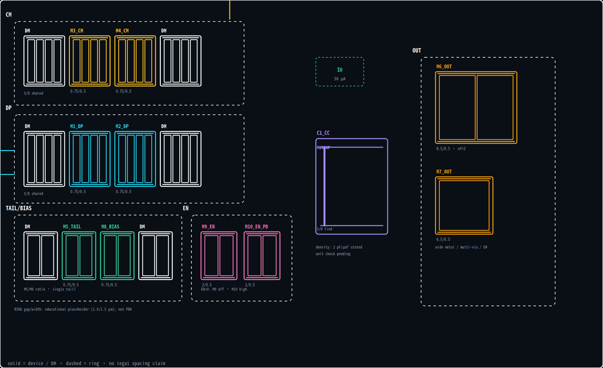

# Layout Card — SKY130 two-stage Miller OP

**版本**：v0.1 · **owner**：analog + layout · **状态**：draft · **阅读目标**：2 分钟
**产物**：[netlist](../../../examples/sky130_two_stage_opamp/opamp.sp) · [constraints](constraints.yaml) · [area report](../../../docs/targets/sky130-opamp/area_report.md) · [floorplan](../../../docs/targets/sky130-opamp/floorplan.png) · [HANDOFF](../../../docs/targets/sky130-opamp/HANDOFF.md)

## 1. 一句话 + 信号链

10 MOS + 1 个 3 pF 补偿电容（MOSCAP 首选）的两级 Miller OP，带真实 bias 镜像和 active-high enable；10 pF 负载是外部 testbench，不计入 core 面积。

```text
INP/INN → M1/M2 (DP) → M3/M4 (CM load) → M6/M7 (OUT) → VOUT
                    ↑
              M5_TAIL ← M8_BIAS ← M9_EN / M10_EN_PD
```

## 2. Top 3 risks

1. **DP/CM 匹配环境不一致** → offset、CMRR、镜像比例、温漂。
   `M1/M2` 和 `M3/M4` 只有 0.75/0.5 µm；任何单侧走线、dummy 或 well/ring 差异都会被小尺寸放大。
2. **EN=0 时 bias 没有真正关断** → `nbias` 浮空/泄漏、`M5/M7` 微导通、启动状态不确定。
   `M9_EN` 必须 off，`M10_EN_PD` 必须把 `nbias` 拉高；`I0` 还是理想源，真实 bias 生成器未验证。
3. **reserve 不够，late decap 会把 floorplan 推翻** → 提议 delta 合计 1827 µm²，PEX-fix reserve 只有 282 µm²，**shortfall 1545 µm²**；其中 2 pF decap 一项就 1467 µm²。
   必须在冻结前决定：加 reserve、砍 decap，还是改 floorplan。

## 3. Must preserve

- `DP`：`M1/M2` 共质心/交叉指状，同方向、同 unit、同 dummy/ring 环境。
- `CM`：`M3/M4` 同 source/well、同边界 dummy；不要跨电源域。
- `TAIL/BIAS`：`M5_TAIL` 与 `M8_BIAS` 的镜像比例和环境；`M5_TAIL` 是单器件，匹配假设弱。
- `EN`：`M9_EN` 在 `EN=0` 时必须真正 off；`M10_EN_PD` 的 pull-up 必须有效，不能只靠仿真初始条件。
- `OUT`：`M6_OUT/M7_OUT` 的电流密度、宽金属、多过孔；`C1_CC=3 pF` 接在第二级/输出节点。
- 端口/对称：`INP/INN/VOUT/VDD/VSS/EN`；对称轴在 x=36.6 µm。
- 6 个 boundary dummy 只在确认接受后保留，且必须左右/上下对称。
- 右侧 8% reserve 条带不要被普通走线吃掉。

## 4. Forbidden

- 禁止时钟/数字/开关控制线跨 `DP`、`CM`、`BIAS` 或 `EN`。
- 禁止把 `DP`/`CM` 拆到不同 well、ring、电源域，或只加单侧 dummy。
- 禁止用最小线宽/单过孔走 `M6_OUT/M7_OUT` 的输出与电源。
- 禁止让 `nbias`/`nsw` 在 `EN=0` 时浮空，或把 `EN` 控制线贴近 `nbias`。
- 禁止为了省面积把 reserve 当普通 routing channel。
- 禁止在没有面积决策和后仿证据时加入 2 pF decap、改 `C1_CC` 或改输出管尺寸。

## 5. Device / match / group

| 组 | 器件 | role | match | 关键要求 |
| --- | --- | --- | --- | --- |
| `DP` | `M1_DP`, `M2_DP` | `input_pair` | `DP` | 共质心、对称 gate routing、boundary dummy |
| `CM` | `M3_CM`, `M4_CM` | `current_mirror` | `CM` | 同 source/well、同环境、boundary dummy |
| `TAIL` | `M5_TAIL` | `tail_current` | `TAIL` | 与 `M8_BIAS` 比例；单器件，确认是否需要 dummy tail |
| `BIAS` | `M8_BIAS` | `bias` | — | diode 连接；远离 EN/数字控制线 |
| `EN` | `M9_EN`, `M10_EN_PD` | `enable_switch` | — | `EN=0` 真关断；pull-up 有效 |
| `OUT` | `M6_OUT`, `M7_OUT` | `output_stage` | — | 宽金属、多过孔、EM/IR |
| `CC` | `C1_CC` | `compensation` | — | 3 pF；非高精度 OP 优先 MOSCAP；MOM/MIM 仅在需要时；注意寄生/耦合 |

**关键尺寸**：`M1/M2/M3/M4/M5/M8 = 0.75/0.5`；`M6 = 8.5/0.5, nf=2`；`M7 = 6.5/0.5`；`M9 = 2/0.5`；`M10 = 1/0.5`；`C1 = 3 pF`。

## 6. Floorplan / white-line layout plan



- **White-line 结构**：`CM` 左上、`DP` 中左、`TAIL/BIAS` + `EN` 左下、`CC` 中右、`OUT` 右侧；`RING` 包 `DP/CM`。
- 每个 MOS 单独成阵列块：`DP/CM` 各 4 指，`M6_OUT` 2 指宽管，`M7_OUT` 1 指长管，`C1_CC` 用 MOSCAP 块（首选）。
- `TAIL/BIAS` 的 `M5/M8` 各 2 指；`EN` 的 `M9/M10` 各 2 指；`I0` 是虚线理想源。
- 这张 white-line 不是合法版图，也不是自动 floorplan；它表达的是**版图结构和摆放意图**。
- 自动 floorplan snapshot（块级）：97.0 × 51.2 µm；aspect 1.90；3 行；利用率 41.8%；[快照](../../../docs/targets/sky130-opamp/floorplan.png)。
- 小于 2 µm 的器件用短 ID（`M1`、`M3`…）；完整名字/role 见上表；这不是合法版图。

## 7. Evidence / open questions

**已有证据**

- 11/11 器件由名字解析出已知 role；`validate --require-known-roles` 通过。
- block 3526 µm²，envelope 3809 µm²，range 2821–4761 µm²；gate **PASS @ 6000 µm²**，headroom 1239 µm²。
- 6 个 proposed dummies；11 个 proposed deltas；reserve shortfall **1545 µm²**。
- floorplan snapshot：3 行、7 组、对称轴 36.6 µm。

**待确认**

- `ASK` `DP` / `CM` / `TAIL` 外侧 dummy 的数量、W/L、栅接法、是否共用 source？owner：analog + layout。
- `ASK` 6 个 boundary dummy 是否接受？`TAIL` 单器件是否需要 dummy tail？owner：analog。
- `ASK` reserve 怎么处理：加到 ≥1827 µm²，还是拒绝 2 pF decap / 改 floorplan？owner：analog + layout。
- `ASK` `EN` 的极性/关断时间/漏电目标是什么？`EN=0` 时 `VOUT` 允许浮空还是必须拉低？owner：analog。
- `ASK` 10 pF 负载、ESD、输出过流是否属于本模块边界？owner：analog + layout。
- `ASK` 是否把理想 `I0` 换成真实 bias 生成器？owner：analog。
- `ASK` `C1_CC` 用 MOSCAP 还是 MOM/MIM？非高精度 OP 先按 MOSCAP，但需要电压系数/线性度/底板寄生确认。owner：analog。
- `ASK` MOS 相对尺寸是否按真实 W/L/area 重画？当前 white-line 是“可读性尺寸”，不是比例尺寸。owner：layout。

**UNKNOWN**

- `UNKNOWN` SKY130 的 WPE/STI/well/ring/dummy 具体间距规则。
- `UNKNOWN` `C1_CC` 的真实 SKY130 电容密度与面积；当前是 generic-180 教育值。
- `UNKNOWN` 输出级 EM/IR、ESD、latch-up 目标。
- `UNKNOWN` `M5_TAIL` 单器件的匹配/噪声边界。

**关闭证据**

- 后仿 DC offset / noise / AC gain / phase margin / stability；
- `EN=0` 的 leakage / 启动 / 关断波形；
- DRC/LVS/PEX 与面积对账；
- reserve/decap 决策记录与版本。

> v0.1 初始编译：只使用名字解析、generic-180 面积、floorplan snapshot；没有 analog/layout 签核结论。
