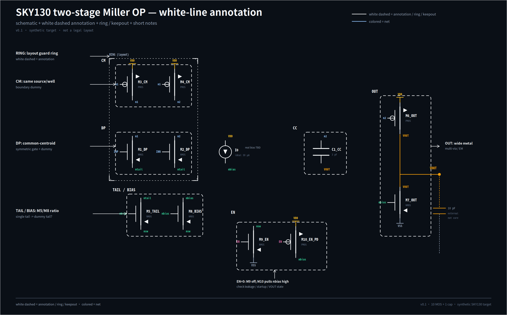

# White-line annotation — SKY130 two-stage OP

## 这是什么

这是**和电路放在同一张 schematic 界面里的白线辅助图**，不是 floorplan，也不是合法版图。

- 白色虚线框：功能组 / keepout / 注释范围；
- 外层双虚线：layout guard ring 的摆放位置；
- 彩色线：实际 net；
- 白色短注释：这个组最怕什么、哪些东西不能动。

它服务于版图工程师的“第一眼”：不用先读完整张网表，就能看到输入对、镜像、tail/bias、enable、输出、补偿和 ring 在哪里。

## 图上标了什么

| 白线 | 对应的电路 | 注释 |
| --- | --- | --- |
| `CM` | `M3_CM/M4_CM` | same source/well · boundary dummy |
| `DP` | `M1_DP/M2_DP` | common-centroid · symmetric gate |
| `RING (layout)` | `DP` + `CM` 外围 | layout guard ring（需确认是否共享） |
| `TAIL / BIAS` | `M5_TAIL/M8_BIAS` | M5/M8 ratio · single tail → dummy tail? |
| `EN` | `M9_EN/M10_EN_PD` | EN=0: M9 off · M10 pulls nbias high |
| `CC` | `C1_CC` | 3 pF · output node |
| `OUT` | `M6_OUT/M7_OUT` | wide metal · multi-via · EM |
| `I0` | ideal 30 µA | real bias TBD |
| `10 pF` | external load | not core area |

## 为什么这样做

版图工程师在 Virtuoso 里最直观的入口不是一张单独的 block diagram，而是**电路图本身 + 白线**。  
白线把“这个组是干什么的、 ring 在哪、哪里不能碰”直接贴在器件旁边，减少口头交接。

## 当前未决

- `ASK` ring 只包 `DP/CM`，还是也要包 `TAIL/BIAS` / `OUT`？
- `ASK` `TAIL` 单器件是否需要 dummy tail？
- `ASK` `EN=0` 时 `VOUT` 允许浮空还是必须拉低？
- `ASK` 6 个 boundary dummy 是否接受？
- `UNKNOWN` SKY130 的 WPE/STI/ring/dummy 具体间距。

## 相关

- [Layout Card](layout-card.md)
- [SVG 源文件](../../../docs/targets/sky130-opamp/white-line.svg)
- [Netlist](../../../examples/sky130_two_stage_opamp/opamp.sp)
