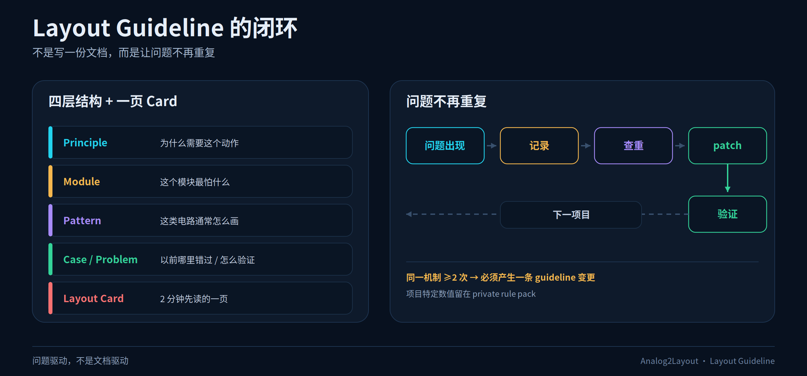

# Layout Guideline

> AI-native layout guideline 的工作区。持续完善中；不含真实 PDK/公司数据。



## 先看什么

1. 先看一页 Layout Card：版图工程师 2 分钟能读完的内容。
   - [two-stage OTA](02-modules/two-stage-ota/layout-card.md)
   - [BGR](02-modules/bgr/layout-card.md)
   - [VCOM](02-modules/vcom/layout-card.md)
   - [BGR vs VCOM 对比](02-modules/bgr-vcom-comparison.md)
2. 再看 [工作流](00-workflow/README.md)：模拟、AI、版图各自做什么。
3. 问题回流见 [07-problems](07-problems/README.md)。
4. 需要下钻时，按 `Principle → Module → Pattern → Case` 找内容。
5. 新增模块时，从 [`05-templates/`](05-templates/) 复制模板。

## 四层结构

| 层 | 目录 | 回答 |
| --- | --- | --- |
| Principle | [`01-principles/`](01-principles/) | 为什么需要这个动作？ |
| Module | [`02-modules/`](02-modules/) | 这个模块最怕什么？ |
| Pattern | [`03-patterns/`](03-patterns/) | 这类电路通常怎么画？ |
| Case | [`04-cases/`](04-cases/) | 以前哪里错过？怎么验证？ |
| Problem | [`07-problems/`](07-problems/) | 怎么从问题回流到 guideline，避免重复犯？ |

## 两个关键补充

- **敏感区/复用**：面积不是纯器件；敏感区包含 ring、WPE 间距、dummy、屏蔽、走线预留，可复用但要带版本条件。见 [`01-principles/sensitive-region-reuse.md`](01-principles/sensitive-region-reuse.md)。
- **目标 bbox/长宽比**：同一总面积，200×200 和 100×400 是不同摆放。见 [`docs/10-layout-variants.md`](../docs/10-layout-variants.md)。

## 一页 Card 的 7 个区块

1. 模块一句话 + 信号链
2. Top 3 risks
3. Must preserve
4. Forbidden
5. Device / match / group 表
6. Floorplan + 关键区域
7. Evidence / open questions / owner / version

模板：[`05-templates/layout-card.md`](05-templates/layout-card.md)

## 目录

```text
layout-guideline/
  README.md
  00-workflow/                角色、步骤、交付物、版本
  01-principles/              匹配、电源、寄生、ESD、密度
  02-modules/                 模块 card（含一个合成示例）
  03-patterns/                diff pair、current mirror 等画法
  04-cases/                   脱敏案例与反例
  05-templates/               card / intent / area-target / change-log
  06-sources/                 来源、证据等级、公开/私有边界
  07-problems/                问题记录与 guideline patch
```

## 使用顺序

```text
模拟填 intent + 名字/role 语义
  → AI 编译 Layout Card
  → 版图读 Card，标偏差
  → 双方解决 open questions
  → 更新 card / case，版本 +1
  → 问题回流 07-problems → principle/pattern 更新
```

详细说明见 [`docs/08-ai-layout-guideline.md`](../docs/08-ai-layout-guideline.md)。

## 边界

- 这里的原则和示例是通用的、合成的；
- 具体数值、公司规则、真实项目案例放在私有层；
- 不提供培训助手、主审、审计服务；只提供技术交互所需的 guideline / card / intent / change log。
